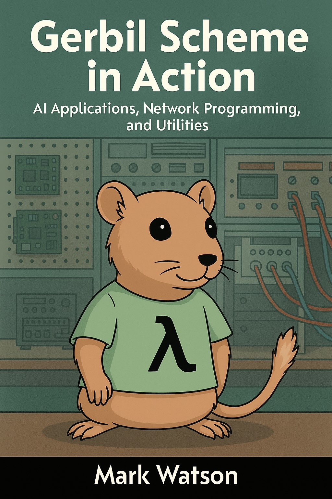

# Example code and book manuscript for Mark Watson's book "Gerbil Scheme in Action: AI Applications, Network Programming, and Utilities"

Using Gerbil Scheme for implementing many short AI examples including LLMs, vector datastore, NLP, semantic web and non-AI utilities.

Dear readers, I hope you enjoy these examples!

Link to book on LeanPub:

[https://leanpub.com/Gerbil-Scheme](https://leanpub.com/Gerbil-Scheme)

Read this book in the manuscript subdirectory:

[manuscript/TOC.md](./manuscript/TOC.md)

## Example code for "Gerbil Scheme in Action: AI Applications, Network Programming, and Utilities"

The code is contained in the same repository as the manuscript, in the subdirectory **source_code**:

[Source code directory](./source_code) | [Source code map](./SOURCE_CODE_MAP.md)

### License for Book Manuscript: Creative Commons Attribution-NonCommercial-ShareAlike 4.0 International (CC BY-NC-SA 4.0)

Copyright 2025-2026 Mark Watson.

This manuscript is licensed under the Creative Commons Attribution-NonCommercial-ShareAlike 4.0 International License (CC BY-NC-SA 4.0). You are free to share and adapt this work for non-commercial purposes with appropriate attribution under the same license terms. See [LICENSE_book_Creative_Commons_Attribution-NonCommercial-ShareAlike-4.0](./LICENSE_book_Creative_Commons_Attribution-NonCommercial-ShareAlike-4.0).

### License for Book Example Source Code: GNU LESSER GENERAL PUBLIC LICENSE Version 2.1

Copyright 2025 Mark Watson. All rights reserved.

Please note that the LGPL is "business friendly": you can use the source code for any purposes if you reference my copyright and code origin.

## Request from the author

Please visit my web site: https://markwatson.com

I appreciate readers supporting my work by buying my books even though they can be read free online: [https://leanpub.com/u/markwatson](https://leanpub.com/u/markwatson)

Follow me on Mastodon: [https://mastodon.social/@mark_watson](https://mastodon.social/@mark_watson)

Subscribe to me on Substack: [https://marklwatson.substack.com](https://marklwatson.substack.com)

Follow me on X: [https://x.com/mark_l_watson](https://x.com/mark_l_watson)

Follow me on Facebook: [https://www.facebook.com/markwatson314](https://www.facebook.com/markwatson314)